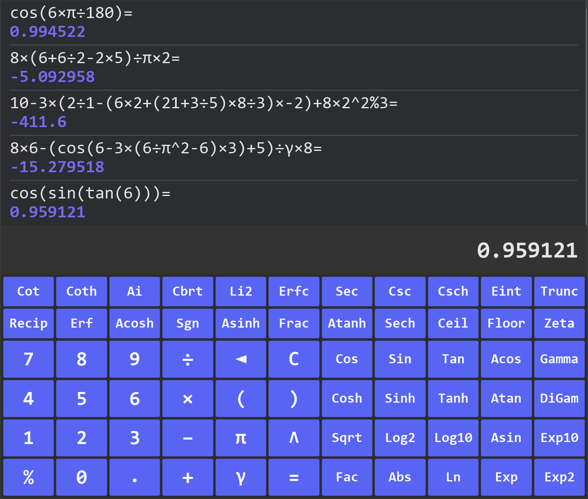

# 高性能高级表达式计算器

### 使用Rust+Rug+Iced编写，支持任意精度超大数运算。

### 计算器使用简介:

- 经过极致性能优化(零拷贝解析)
- 保证数值精确范围(默认: 小数后6位零误差)
- 完美支持任意深度的括号嵌套、函数嵌套以及多参数组合嵌套。
- 支持科学计数法: `1.23e-5`, `1.23E-5`, `1.23e+5`, `1.23E5`
- 智能识别负数和减号: `-5`, `-1e-10`, `10-5`, `10+-5`
- 用户自定义计算精度(默认: 2560Bit)
- 符号`C`= 清空输入框表达式【快捷键】`Delete`
- 符号`◄`= 清除输入框一个字符【快捷键】`Backspace`
- 符号`%`= 求模运算符【快捷键】`Shift+5`
- 符号`π`= 圆周率常数【快捷键】`Shift+p`
- 符号`γ`= 欧拉-马歇罗尼常数【快捷键】`Shift+y`
- 符号`^`= 乘方运算符【快捷键】`Shift+6`
- 符号`()`= 括号运算符【快捷键】`Shift+9 or 0`或`[]`
- 历史列表= 清空历史记录【快捷键】`Ctrl+Delete`
- 函数`exp(1)`= 自然常数e的值
- 双参数函数`atan2(3.0, -4.0)`= 两个参数用英文逗号分隔
- 三角函数`Default: Radian`= 弧度`Radian`转角度`Degree`例:`cos(6xπ÷180)`
- 函数`sqrt(2)`= 平方根函数(开根号)
- 函数`fac(9)`= 阶乘函数
- 输入表达式支持键盘绑定

### 数学函数支持列表:
- 高级数学函数【单参数】: `ai`, `abs`, `cos`, `sin`, `tan`, `csc`, `sec`, `cot`, `coth`, `ceil`, `cosh`,
- `tanh`, `sech`, `ln`, `csch`, `acos`, `asin`, `atan`, `acosh`, `asinh`, `atanh`, `log2`, `log10`, `sqrt`,
- `cbrt`, `fac`, `erf`, `li2`, `exp`, `exp2`, `exp10`, `eint`, `zeta`, `trunc`, `gamma`, `floor`, `fract`,
- `signum`, `erfc`, `digamma`, `recip`, `ln_gamma`, `j0`, `j1`, `y0`, `y1`, `square`, `sinh`
- 高级数学函数【双参数】: `root`, `max`, `min`, `sinu`, `atan2`, `hypot`, `tanu`, `gamma_inc`,
- `positive_diff`, `remainder`, `rooti`, `agm`, `pow`, `jn`, `yn`, `copysign`

自创词法解析算法，一次遍历即完成计算，核心代码652行并包含错误检查机制。
